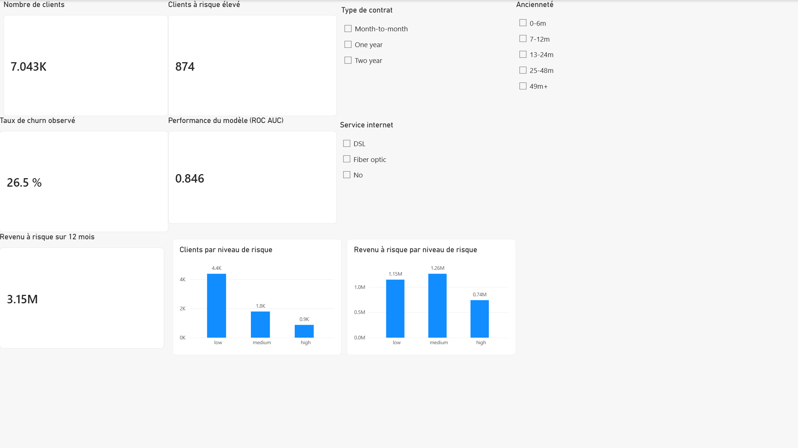
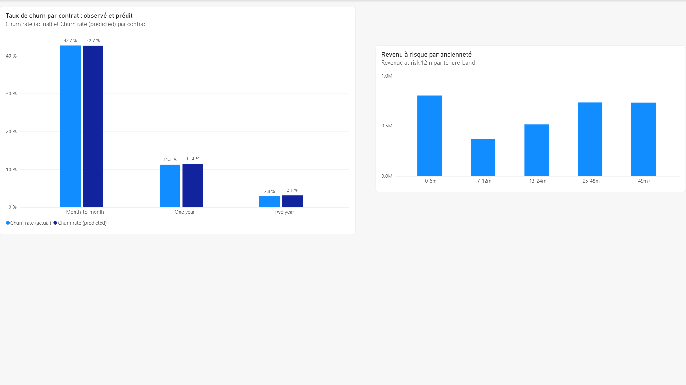
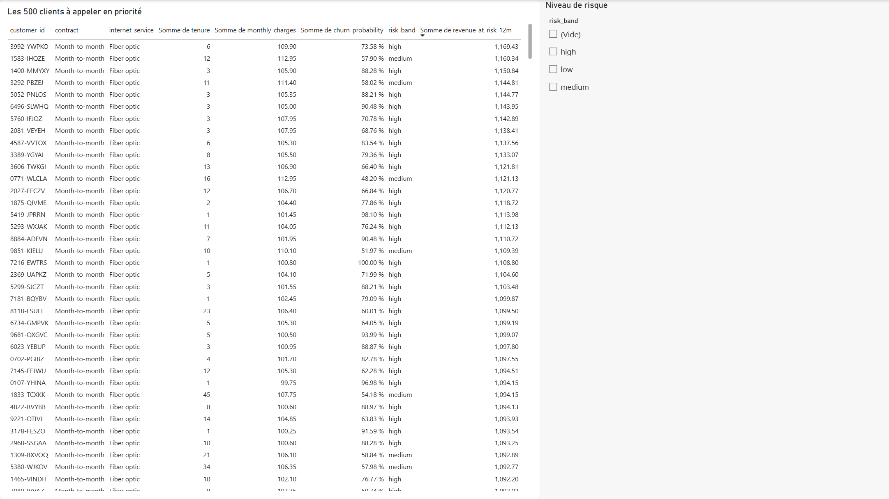
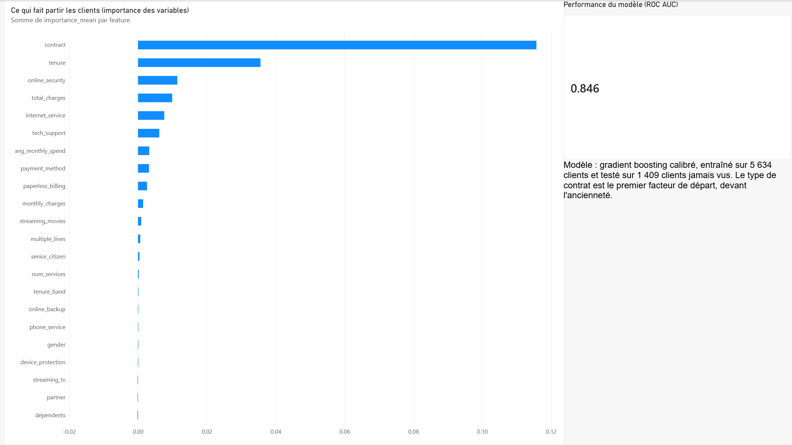

# Power BI report

[churn_report.pbix](churn_report.pbix) is a four-page report built in Power BI Desktop on the views created by `python -m churn.db`. No transformation happens in Power BI: every number comes from a SQL view or from one of the ten DAX measures below, so it can be traced back to `customer_scores`.

[churn_report.pdf](churn_report.pdf) is a PDF export of the four pages. The screenshots below come from the same file.

## Pages

### 1. Synthèse (overview)



- Cards: Customers (7,043), Churn rate (actual) (26.5%), Revenue at risk 12m (3.15M), High-risk customers (874), Test AUC (0.846).
- Column charts: customers and revenue at risk by risk band.
- Slicers: contract, tenure_band, internet_service. They filter every visual on the page, so clear them before reading the totals.

### 2. Segments



- Clustered columns: actual vs predicted churn rate by contract. The pairs sit together (42.7% vs 42.7%, 11.3% vs 11.4%, 2.8% vs 3.1%), which is what calibration is for; if they diverged, the model would be miscalibrated on that segment. The page shows the whole base. On the 1,409 test customers alone the pairs are 42.6% vs 42.8%, 12.0% vs 11.1% and 2.7% vs 3.5%.
- Columns: revenue at risk by tenure band. Customers past four years rarely leave (10% average risk), but they are the largest and best-paying group, so they carry 0.73M, close to the 0.80M of customers in their first six months.

### 3. Liste de rétention (retention list)



- Table from `v_top_revenue_at_risk`: the 500 customers with the most revenue at risk, sorted by it. This is the call list for a retention team. Ranking by money rather than by probability changes who is on it: 260 of the 500 are medium-risk customers with large bills.
- Slicer: risk band.

### 4. Modèle (model)



- Bar chart from `feature_importance`: permutation importance on the test set. Contract type is far ahead, then tenure.
- Card: test ROC AUC, with a note on how the model was trained and tested.

Pages 1, 2 and 4 read `v_customer_risk` through the measures. The smaller summary views (`v_churn_by_contract`, `v_churn_by_tenure_band`, `v_risk_band_summary`) are loaded as well and give the same totals, which is a quick way to check a measure.

## Open the report

The .pbix imports the CSV files in [data/](data/), written from the views by:

```bash
python -m churn.train
python -m churn.db
python -m churn.export_powerbi   # writes powerbi/data/*.csv
```

The .pbix stores the folder the files were imported from. After cloning, if Power BI cannot find them: Transform data (Transformer les données) → Data source settings → Change source, and pick your `powerbi/data/` folder.

### Or connect to PostgreSQL

1. Power BI Desktop, Get data, PostgreSQL database.
2. Server `localhost:5432` (or the Azure host), database `churn`. User `churn`, password `churn` for the Docker setup.
3. Import mode. Select these views:
   - `v_customer_risk` (one row per customer, the fact table)
   - `v_churn_by_contract`
   - `v_churn_by_tenure_band`
   - `v_risk_band_summary`
   - `v_top_revenue_at_risk`
   - `model_metrics` and `feature_importance` (tables)

The CSV export adds two sort columns to `v_customer_risk` (see below); with a direct connection, add them in Power Query or sort the axes by hand.

## Measures (DAX)

Create these on `v_customer_risk` (also in [measures.dax](measures.dax), one per block):

```dax
Customers = COUNTROWS('v_customer_risk')

Churn rate (actual) = AVERAGE('v_customer_risk'[actual_churn])

Churn rate (predicted) = AVERAGE('v_customer_risk'[churn_probability])

Monthly revenue = SUM('v_customer_risk'[monthly_charges])

Revenue at risk 12m = SUM('v_customer_risk'[revenue_at_risk_12m])

Expected revenue 12m = SUM('v_customer_risk'[expected_revenue_12m])

Revenue at risk share =
DIVIDE([Revenue at risk 12m], [Monthly revenue] * 12)

High-risk customers =
CALCULATE([Customers], 'v_customer_risk'[risk_band] = "high")

High-risk revenue at risk =
CALCULATE([Revenue at risk 12m], 'v_customer_risk'[risk_band] = "high")

Test AUC =
CALCULATE(
    MAX('model_metrics'[value]),
    'model_metrics'[model_name] = "selected_calibrated",
    'model_metrics'[split] = "test",
    'model_metrics'[metric] = "roc_auc"
)
```

Both churn rates are formatted as percentages.

## Sort columns

Power BI sorts text alphabetically, which puts "13-24m" before "7-12m" and "high" before "low". In `v_customer_risk`, `tenure_band` is sorted by `tenure_band_order` and `risk_band` by `risk_band_order` (Column tools → Sort by column), and the chart axes are sorted ascending on those fields.

## Refresh

Re-run `python -m churn.train && python -m churn.db && python -m churn.export_powerbi`, then Refresh in Power BI. `scored_at` and `model_version` on every row tell you which run you are looking at.
